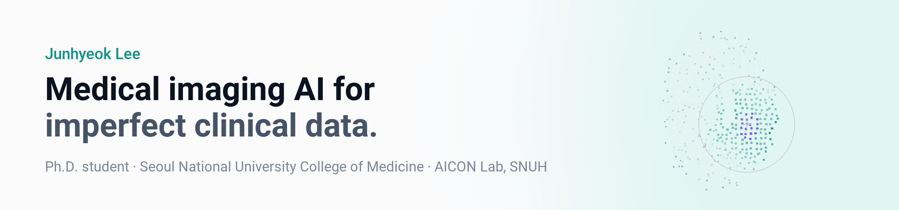

<a href="https://jhlee0619.github.io">
  <picture>
    <source media="(prefers-color-scheme: dark)" srcset="assets/banner-dark.png">
    
  </picture>
</a>

I'm a Ph.D. student at Seoul National University College of Medicine, working in the AICON Lab (Department of Radiology, Seoul National University Hospital) with Prof. Kyu Sung Choi. I study medical imaging AI for clinical data that is noisy, incomplete, or context-dependent — multimodal survival prediction, image synthesis for acute stroke, physics-informed perfusion modelling, and the safety of language models used with clinical text.

[Website](https://jhlee0619.github.io) · [Google Scholar](https://scholar.google.com/citations?user=uQGNBV0AAAAJ) · [Hugging Face](https://huggingface.co/jhlee0619) · evening0619@gmail.com

### Research code

| Repository | What it is | Paper |
| --- | --- | --- |
| [EPPINN](https://github.com/jhlee0619/EPPINN) | Evidential physics-informed perfusion model with voxel-wise uncertainty | MICCAI 2026 |
| [PIRTA](https://github.com/jhlee0619/PIRTA) | Retrieval-augmented 3D brain MRI report generation | MICCAI 2026 |
| [mpib-eval](https://github.com/jhlee0619/mpib-eval) | Evaluation toolkit for the MPIB medical prompt-injection benchmark ([dataset](https://huggingface.co/datasets/jhlee0619/mpib)) | Findings of EMNLP 2026 |
| [LDM3D-LAPT](https://github.com/jhlee0619/LDM3D-LAPT) | 3D latent diffusion with lesion-aware post-training, CT perfusion → DWI/ADC | MICCAI 2025 |
| [BoxPINN](https://github.com/jhlee0619/BoxPINN) | Minimal BoxPINN implementation for CT perfusion reconstruction | — |
| [Glioma-Tumor-Habitat](https://github.com/jhlee0619/Glioma-Tumor-Habitat) | Perfusion habitat analysis for diffuse glioma: trained models and inference | under review |

From the lab: [GlioSurv](https://github.com/snuh-rad-aicon/GlioSurv) · [Diffusion-LAPT](https://github.com/snuh-rad-aicon/Diffusion-LAPT) · [Interactive-MEN-RT](https://github.com/snuh-rad-aicon/Interactive-MEN-RT)

### Tools

| Repository | What it does |
| --- | --- |
| [citecheck](https://github.com/jhlee0619/citecheck) | MCP server that checks references against PubMed, Crossref, arXiv, and Semantic Scholar ([npm](https://www.npmjs.com/package/@jhlee0619/citecheck)) |
| [local-citation-verifier](https://github.com/jhlee0619/local-citation-verifier) | BibTeX citation checker that runs in the browser with WebGPU reranking ([demo](https://jhlee0619.github.io/local-citation-verifier/)) |
| [research-dojo](https://github.com/jhlee0619/research-dojo) | Local research workflow with Claude Code and Codex subagents |
| [adversarial-paper-writing](https://github.com/jhlee0619/adversarial-paper-writing) | Codex skill for evidence-locked review and revision of paper drafts |
